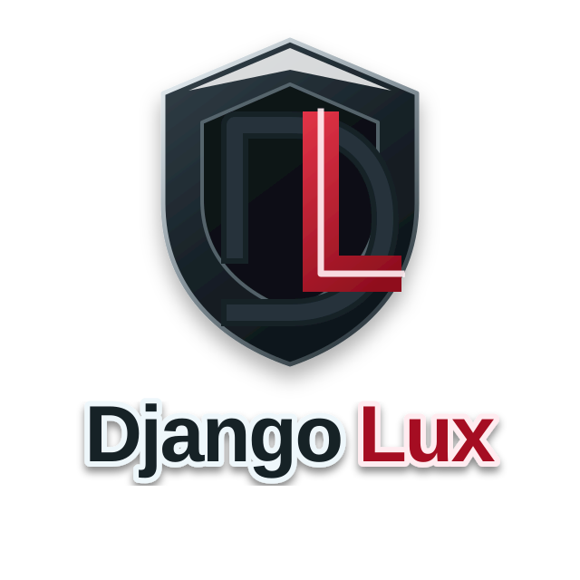

# DjangoLux — A Modern UX/UI Framework for Django

[](https://pypi.org/project/django-lux/)
[](https://pypi.org/project/django-lux/)
[](https://www.djangoproject.com/)
[](https://github.com/debeski/django-lux/blob/main/LICENSE)
[](https://pypi.org/project/django-lux/)

<p align="center">
  
</p>

DjangoLux is a design-first UX/UI framework for Django. It ships a themeable design
system on Bootstrap 5 (built-in and custom themes, custom fonts, full RTL/LTR and
multilingual rendering) together with the infrastructure a real application needs:
a first-launch setup wizard, users, scopes and two-factor sign-in, an audit trail,
zero-boilerplate CRUD, tables, document files, backups and a built-in task runner.
All of it is wired together and configurable at runtime, so a project spends its
code on its own features.

`python -m dlux startproject` generates a project already wired for DjangoLux, with a
Docker Compose stack that [Composer](https://github.com/debeski/composer) deploys,
checks and updates. The long-form manual lives in
[`docs/`](https://github.com/debeski/django-lux/blob/main/docs/README.md).

## Highlights

- **Configuration:** a 19-step first-launch wizard at `/sys/setup/`, live System
  Settings editors, a database-backed `SystemSettings` over the `DLUX_CONFIG`
  fallback, and themes, fonts and translations edited in the UI.
  [System Configuration](https://github.com/debeski/django-lux/blob/main/docs/system-configuration.md)
- **Security and accounts:** password policy, lockout, email and TOTP two-factor
  sign-in, trusted devices, staff tiers and scopes, optional email-verified public
  registration, and optional OIDC SSO packages.
  [DSRP-1](https://github.com/debeski/django-lux/blob/main/docs/security-dsrp-1.md) ·
  [Operations](https://github.com/debeski/django-lux/blob/main/docs/operations.md)
- **Operations:** an activity log and reports; encrypted full, data-only, portable
  and incremental backups with an offline `.dlb` viewer; managed assets; and a
  database-backed task runner (`dlux_worker`) for DjangoLux's and the project's
  background work.
  [Backups](https://github.com/debeski/django-lux/blob/main/docs/backups.md) ·
  [Task Runner](https://github.com/debeski/django-lux/blob/main/docs/task-runner.md)
- **Tables, forms and UI:** `DluxTable` with administrator and personal column
  layouts, the list-page ribbon, sections and dynamic-modal CRUD, context-menu
  actions, global search, tutorials and Dlux-owned inputs.
  [UI Integration](https://github.com/debeski/django-lux/blob/main/docs/ui-integration.md) ·
  [Table Columns](https://github.com/debeski/django-lux/blob/main/docs/table-columns.md)
- **Documents:** one `register_document_file()` call connects upload, ScanLink
  scanning, a viewer, page editing and file history to a model field, with OCR and
  the PDF toolkit as optional extras.
  [Document Files](https://github.com/debeski/django-lux/blob/main/docs/document-files.md)
- **Deployment and updates:** the generated Compose stack, verified inline updates
  on a stable or beta channel, the Operations panel, the deployment doctor,
  non-root app images, and outbound requests only through the Composer relay.
  [Verified Inline Updates](https://github.com/debeski/django-lux/blob/main/docs/inline-updater.md) ·
  [Deployment Doctor](https://github.com/debeski/django-lux/blob/main/docs/doctor.md)
- **Developer integration:** `dlux_settings(globals())`, root `dlux.urls`, app
  scaffolds, `ScopedModel` with audit fields, soft delete and actor tracking, and
  template extension points.
  [Developer Guide](https://github.com/debeski/django-lux/blob/main/docs/developer-guide.md)

Every capability, with the doc that explains it, is in
[Features](https://github.com/debeski/django-lux/blob/main/docs/FEATURES.md).

## Quick Start

DjangoLux needs Python 3.11 or later (tested on 3.11 to 3.14) and Django 5.1 or
later. Its other dependencies install with it.

### A new project

```bash
pip install django-lux
python -m dlux startproject myproject --image acme/myproject --repo acme/myproject
cd myproject
./start.sh -d -b
```

`startproject` writes a Django project wired for DjangoLux, a Compose stack (`web`,
`worker`, `db`, `redis`, Caddy, the SMTP relay, the `ocr` service and Composer's
agent), `.secrets/.env` with the bootstrap secrets, and a tag-driven release
pipeline. `--image` is the Docker image the deployment pulls and the release
workflow pushes, and `--repo` is the GitHub repository for release links. On a
terminal it prompts for both; `--no-input` keeps the defaults.

`./start.sh -d -b` builds the image and starts the development stack. The first
boot creates the superuser `admin` with the `ADMIN_PASS` from `.secrets/.env`; sign
in and complete the setup wizard at `/sys/setup/`. Add an app with
`python -m dlux startapp billing --register`.

### An existing Django project

1. Call the settings helper at the end of `settings.py`. It adds the required apps,
   middleware, context processor and Crispy Bootstrap 5 settings, and fills in the
   runtime defaults your settings do not already set.

   ```python
   from dlux.utils import dlux_settings

   dlux_settings(globals())
   ```

2. Mount `dlux.urls` at the project root, which serves `/accounts/...` and
   `/sys/...`.

   ```python
   from django.urls import include, path

   urlpatterns = [
       path("", include("dlux.urls")),
   ]
   ```

3. Run `python manage.py dlux_setup`, which applies DjangoLux's migrations and runs
   the deployment doctor. Then sign in as a superuser and complete `/sys/setup/`.

[Getting Started](https://github.com/debeski/django-lux/blob/main/docs/getting-started.md)
covers manual wiring, mounting under a prefix, running behind a front proxy and
what the first launch does.

## Optional Extras

```bash
pip install "django-lux[pdf,ocr]"
```

| Extra | Adds |
|:--|:--|
| `pdf` | `pypdf`, for the [PDF toolkit](https://github.com/debeski/django-lux/blob/main/docs/pdf-toolkit.md)'s server-side assembly. |
| `ocr` | The engine of the optional `ocr` service, pinned exactly. It needs Python 3.14 or earlier, because `onnxruntime` publishes no Python 3.15 wheels; generated project images build on `python:3.14-slim`. See [OCR](https://github.com/debeski/django-lux/blob/main/docs/ocr.md). |
| `sso` | `django-lux-sso`, the OIDC provider plugin. The client SDK is the separate `django-lux-sso-client` package. See [SSO](https://github.com/debeski/django-lux/blob/main/docs/sso.md). |
| `updater` | `pypi-attestations`. Generated projects install it with `ocr`; DjangoLux does not import it, because Composer downloads, attests and stages every release. |

## Deployment with Composer

Generated projects deploy with [Composer](https://github.com/debeski/composer),
DjangoLux's containerized operations companion. `./start.sh` (or `start.ps1`) runs
Composer from its image, so the host needs Docker but no local Python or Compose
toolchain. Composer resolves the secrets, brings the stack up, waits for health checks and applies updates. Inside
the stack, `composer-agent` checks for DjangoLux releases and project images and
relays the stack's outbound requests, since `web` and `worker` have no internet
access. `composer-executor`, which is not network-facing, holds the only Docker
write access.

| DjangoLux | Composer | DLUX Control Plane (optional) |
|:--|:--|:--|
| Application policy: backups, maintenance, update admission and locking, migration safety, permissions and final application state. | Container execution: secret handoff, registry checks, the Compose lifecycle, health verification, deployment status and the agent relay. | Fleet coordination: enrollment, authorization, typed command routing, batches, audit history and relayed snapshots. |

DjangoLux decides whether an operation may proceed; Composer performs the container
work. The agent has no inbound listener and accepts only typed, allowlisted
operations, and local operations keep working while the Control Plane is
unreachable.

```bash
./start.sh            # start the production stack
./start.sh -d         # start with the development override
./start.sh update     # pull and recreate updated services
./start.sh check      # check the stack; --fix applies recognized migrations
```

See [Composer Agent Integration](https://github.com/debeski/django-lux/blob/main/docs/composer-agent.md),
[Verified Inline Updates](https://github.com/debeski/django-lux/blob/main/docs/inline-updater.md),
[Outbound Requests](https://github.com/debeski/django-lux/blob/main/docs/outbound-requests.md)
and the [Composer image](https://hub.docker.com/r/debeski/composer).

## Built with DjangoLux

| Project | What it shows |
|:--|:--|
| [**Switch POS**](https://github.com/debeski/dlux-crm)<br><sub>Sales CRM · POS · Catalog · Finance</sub> | A sales system covering product catalogs, inventory, hybrid-currency pricing, invoices, finance and role-controlled sales workflows, on DjangoLux as the foundation of a day-to-day business application. |
| [**DLUX Control Plane**](https://github.com/debeski/dlux-panel)<br><sub>Fleet management · Secure operations · Deployment</sub> | A scoped control plane that monitors and operates fleets of DjangoLux Compose deployments through their outbound agents: enrollment, typed operational commands, update orchestration, audit history and security-focused administration. |

## Documentation

- [Documentation index](https://github.com/debeski/django-lux/blob/main/docs/README.md): every guide, grouped for operators and developers
- [Features](https://github.com/debeski/django-lux/blob/main/docs/FEATURES.md): the capability map
- [Getting Started](https://github.com/debeski/django-lux/blob/main/docs/getting-started.md): install, wiring and first launch
- [Developer Guide](https://github.com/debeski/django-lux/blob/main/docs/developer-guide.md): the mental model and integration patterns
- [Deployment Configuration](https://github.com/debeski/django-lux/blob/main/docs/deployment-configuration.md): every `DLUX_*` setting and environment variable
- [Reference](https://github.com/debeski/django-lux/blob/main/docs/reference.md): commands, routes, template tags and helpers
- [Standalone .dlb Backup Viewer](https://github.com/debeski/django-lux/blob/main/tools/dlb-viewer/README.md)
- [Migrating from django-microsys](https://github.com/debeski/django-lux/blob/main/docs/migrating-from-microsys.md)
- [Changelog](https://github.com/debeski/django-lux/blob/main/CHANGELOG.md) and [Releasing](https://github.com/debeski/django-lux/blob/main/docs/RELEASING.md)
- [Security Policy](https://github.com/debeski/django-lux/blob/main/SECURITY.md), [Contributing Guide](https://github.com/debeski/django-lux/blob/main/CONTRIBUTING.md) and [Code of Conduct](https://github.com/debeski/django-lux/blob/main/CODE_OF_CONDUCT.md)

## License

DjangoLux is released under the [MIT License](https://github.com/debeski/django-lux/blob/main/LICENSE).
